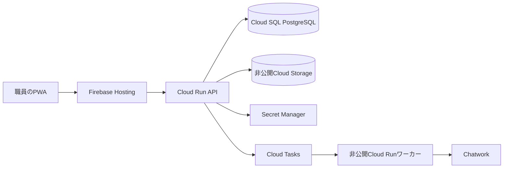

# KIIYA環境台帳・配備と復旧手順（2026-10-14）

本書は[初期構成](infrastructure-and-access.md)を環境構築時にそのまま登録できる値と手順にしたもの。**Google CloudのKIIYA用プロジェクトと有料リソースはまだ作成していない。** プロジェクトIDは作成時に全世界で一意である必要があり、作成後は変更できない。下記のIDを作成画面で確保し、衝突した場合は検証・本番の両IDに同じ新しい接尾辞を付けて本書を更新する。[Google CloudのプロジェクトID](https://docs.cloud.google.com/resource-manager/docs/creating-managing-projects)

## 1. 環境台帳

| 項目 | 検証 | 本番 |
| --- | --- | --- |
| プロジェクト表示名 | KIIYA Cleaning Checker Staging | KIIYA Cleaning Checker Production |
| 作成予定のプロジェクトID | `kiiya-cleaning-stg-cd72a4` | `kiiya-cleaning-prod-cd72a4` |
| 請求先 | 「請求先アカウント 1」（利用可能であることを確認済み） | 同左 |
| 配置リージョン | `asia-northeast1`（東京） | `asia-northeast1`（東京） |
| Cloud Run | `kiiya-api`、非公開の`kiiya-worker` | 同じ名前で別プロジェクトに配置 |
| Cloud SQL | `kiiya-pg-stg`、PostgreSQL 16／Cloud SQL Enterprise、単一ゾーン、`db-f1-micro`、SSD 10 GiBから開始 | `kiiya-pg-prod`、PostgreSQL 16／Cloud SQL Enterprise、単一ゾーン、`db-g1-small`、SSD 10 GiBから開始 |
| Cloud Storage | 非公開バケット`kiiya-cleaning-stg-cd72a4-images` | 非公開バケット`kiiya-cleaning-prod-cd72a4-images` |
| Firebase Hosting | 同プロジェクトの既定サイト | 同プロジェクトの既定サイト |
| Cloud Tasks | `kiiya-notify` | `kiiya-notify` |
| ランタイム用サービスアカウント | `kiiya-api`、`kiiya-worker`、`kiiya-tasks` | 同じIDで別プロジェクトに作成 |
| Secret Manager | `kiiya-chatwork-client-secret`、`kiiya-chatwork-refresh-token` | 同名の別シークレット |

Cloud Storageのバケット名も全世界で一意なので作成時に確認する。PostgreSQL 16では既定のCloud SQLエディションがEnterprise Plusになり得るため、作成時は**Enterpriseを明示指定**する。[エディション選択](https://docs.cloud.google.com/sql/docs/postgres/choose-edition) Cloud SQLの共有コアと単一ゾーンは費用重視のMVP初期値で、[Cloud SQLのSLA対象外](https://docs.cloud.google.com/sql/docs/operational-guidelines)。可用性が必要になれば専用コア・高可用性へ移す。SSD容量は自動拡張を有効にし、拡張による請求増を監視する。データベースの実サイズ・接続数・CPU・応答時間を実運用で見て構成を更新する。



この構成を検証・本番の**別プロジェクト**にそれぞれ作り、DB、画像、キュー、シークレット、Chatworkルームを共有しない。

## 2. 担当と権限

| 作業 | 主担当 | 実行・確認 |
| --- | --- | --- |
| プロジェクト作成、請求先接続、IAM、API有効化 | `samonkntd@gmail.com` | 本人が実行し、両プロジェクトのID・請求先・権限を台帳で確認 |
| Cloud SQL設定、日次バックアップ監視、復元、マイグレーション | `samonkntd@gmail.com` | 本人が実行し、操作日時・バックアップID・復元先・検証結果を運用記録へ残す |
| Cloud Run・Firebase Hostingの配備、障害時の切替 | `samonkntd@gmail.com` | 検証環境で先に成功させ、本番の反映結果を記録 |
| 費用閲覧、予算アラートへの対応 | `samonkntd@gmail.com` | 検証・本番の請求実績を別々に確認 |
| アプリ内のChatwork接続・rid設定 | 登録する社内IT担当者 | アプリ内のIT権限を持つアカウントを運用開始時に登録。Google Cloud管理権限とは別 |

復旧の代行者は当面置かない〔利用者確認済み〕。主担当のGoogleアカウントで二段階認証と復旧手段を有効にし、主担当不在時は復旧作業が遅れることを運用上の制約として明示する。サービスアカウントに人用の管理者権限を付けず、詳細なランタイム権限は[権限設計](infrastructure-and-access.md)に従う。

## 3. Cloud SQLバックアップの初期設定

| 設定 | 検証・本番の初期値 |
| --- | --- |
| バックアップ方式 | Cloud SQL標準バックアップ。日次自動バックアップ |
| 開始ウィンドウ | `18:00 UTC`（日本時間03:00開始の4時間枠） |
| 自動バックアップ保持 | 14件（日次なら約14日分） |
| 時点復旧（PITR） | 有効。トランザクションログを7日保持 |
| インスタンス削除防止 | 有効 |
| 削除後のバックアップ保持 | 有効。バックアップ自身の期限まで保持 |
| インスタンス削除時の最終バックアップ | 有効。30日保持 |
| スキーマ変更前 | 本番でオンデマンドバックアップを取得し、成功IDを記録 |

共有コアのCloud SQL EnterpriseでもPITRは設定可能。CLIやAPIで作るインスタンスではPITRが既定で無効の場合があるため、**明示的に有効化**する。[標準バックアップの設定](https://docs.cloud.google.com/sql/docs/postgres/backup-recovery/manage-standard-backups) / [PITRの設定](https://docs.cloud.google.com/sql/docs/postgres/backup-recovery/configure-pitr) / [削除時のバックアップ](https://docs.cloud.google.com/sql/docs/postgres/backup-recovery/backups)

標準バックアップは元のCloud SQLと同じプロジェクトに保存される。インスタンス削除には備えるが、**プロジェクト全体を削除した場合の独立した復旧先は持たない**。MVPでは費用を優先してこの構成から始め、実運用の費用と復旧演習を見て別プロジェクトのBackup and DRへ移すか判断する。[バックアップ方式の比較](https://docs.cloud.google.com/sql/docs/postgres/backup-recovery/backup-options)

インスタンス作成後、主担当は次の値を指定・確認する。`--project`を必ず付けて環境の取り違えを防ぐ。設定変更によって再起動する項目があるため、本番では作業時間を設ける。

```sh
gcloud sql instances patch kiiya-pg-prod --project=kiiya-cleaning-prod-cd72a4 \
  --backup-start-time=18:00 --retained-backups-count=14 \
  --enable-point-in-time-recovery --retained-transaction-log-days=7 \
  --deletion-protection --retain-backups-on-delete \
  --final-backup --final-backup-retention-days=30
gcloud sql instances describe kiiya-pg-prod --project=kiiya-cleaning-prod-cd72a4
gcloud sql backups list --instance=kiiya-pg-prod --project=kiiya-cleaning-prod-cd72a4
```

検証環境ではプロジェクトIDとインスタンス名を検証用に置き換える。コマンドの実行は実際のインスタンス作成後とし、この文書の作成時点では実行していない。

## 4. 監視、復元、演習

1. **毎日09:00（日本時間）**に主担当がCloud SQLの前回バックアップの成功、PITRの有効状態、Storageの失敗通知を確認する。バックアップ失敗やPITR停止時は原因を調べ、成功するまで本番のスキーマ変更を止める。復旧不能の可能性を当日中に記録する。
2. **毎週**、バックアップ履歴と直近の復旧可能範囲、DB容量・CPU・接続数、画像バケット容量を確認する。**四半期ごと**に本番のバックアップから隔離した新規インスタンスへ復元する演習を行い、所要時間とデータ検証結果を記録する。演習用インスタンスは本番アプリに接続せず、確認後に削除する。
3. 障害時は主担当がAPI・ワーカーの書き込みとChatwork再送処理を停止し、障害発生時刻と最後に正常と分かる時刻をUTCで記録する。誤操作によるデータ変更でPITRが利用できる場合、正常時刻を指定して**新しいCloud SQLインスタンス**へ復元する。PITRが使えない場合は最後の成功済み日次バックアップを新しいインスタンスへ復元する。旧インスタンスへの上書きは初手で行わない。[Cloud SQLの復元方法](https://docs.cloud.google.com/sql/docs/postgres/backup-recovery/restore) / [PITR手順](https://docs.cloud.google.com/sql/docs/postgres/backup-recovery/pitr)
4. 復元先でスキーマバージョン、作業・報告・マスタの件数、参照整合性、画像オブジェクトの存在、直近の送信IDを確認する。DBがChatwork投稿前の状態へ戻ると重複送信し得るため、報告ID・変更IDをChatwork上の投稿と照合し、結果不明を自動再送しない。確認後にCloud RunのDB接続先を新インスタンスへ切り替え、読み取り・書き込み・報告の順で動作確認してワーカーを再開する。
5. 画像の誤削除には、非公開Cloud Storageバケットの**7日間のソフトデリート**から必要なオブジェクトを復元する。復元対象のオブジェクト名と世代を確認し、元のSHA-256と照合する。ソフトデリートはアプリから見えない削除後も最大7日間、復元用に実体を保持するため、データ保存期間の説明にもこの猶予を明記する。[Cloud Storageソフトデリート](https://docs.cloud.google.com/storage/docs/soft-delete) / [復元手順](https://docs.cloud.google.com/storage/docs/use-soft-deleted-objects)
6. Cloud RunとFirebase Hostingのコード事故は、前回の正常なCloud RunリビジョンとHostingリリースへ戻す。DBのマイグレーションは先に検証環境で実行し、本番でオンデマンドバックアップを成功させてから適用する。DBを戻すと新しい記録が失われる可能性があるため、通常のコード巻戻しとDB復元を混同しない。[Hostingのロールバック](https://firebase.google.com/docs/hosting/manage-hosting-resources)

PITRでは、主担当が確認したUTC時刻を指定して次のように**新規インスタンス**を作る。`RECOVERY_NAME`と`UTC_TIMESTAMP`は障害ごとに決め、元インスタンス名を復元先に使わない。日次バックアップから戻す場合はCloud SQLの「バックアップ」画面で成功済みのバックアップIDを選び、「新しいインスタンスへ復元」を選択する。

```sh
gcloud sql instances clone kiiya-pg-prod RECOVERY_NAME \
  --project=kiiya-cleaning-prod-cd72a4 \
  --point-in-time=UTC_TIMESTAMP
```

復旧時間・失われ得るデータ量の保証値は、初回演習の実測で決める。単一ゾーンの障害は自動フェイルオーバーしないため、主担当が復元・接続先切替を行う。[Cloud SQL単一ゾーンの復旧](https://docs.cloud.google.com/sql/docs/postgres/high-availability)

## 5. 費用と配備時の確認

- 「請求先アカウント 1」を両プロジェクトへ紐付け、プロジェクトごとに予算アラートを設ける。仮の月額通知額は検証**1万円**、本番**3万円**、通知閾値は50%・90%・100%。これは支出上限ではなく警告で、最初の1か月の実績から調整する。[予算アラートの挙動](https://docs.cloud.google.com/billing/docs/how-to/budgets)
- Cloud SQLの常時稼働、バックアップとPITRログ、画像のソフトデリート、四半期の復元演習で料金が増える。費用は検証・本番の請求レポートを週次で確認し、サービス別に記録する。初期構成の月額見積もりはMVPの実測値を得て更新する。
- 配備順は **検証プロジェクト作成・請求先接続 → API有効化とIAM → Cloud SQL・Storage・Secret Manager・Tasks → 検証でマイグレーションと復元演習 → 本番構築 → 本番マイグレーション → Cloud Run API・ワーカー → Firebase Hosting → 実送信の手動確認**。本番用のChatwork投稿アカウントとridは手動テストで登録する。
- 本書の値は**設定予定値**。プロジェクトID、請求先の紐付け、担当者のIAM、バックアップ成功、復元演習の実施結果を確認するまでは「構築済み」と表示しない。
