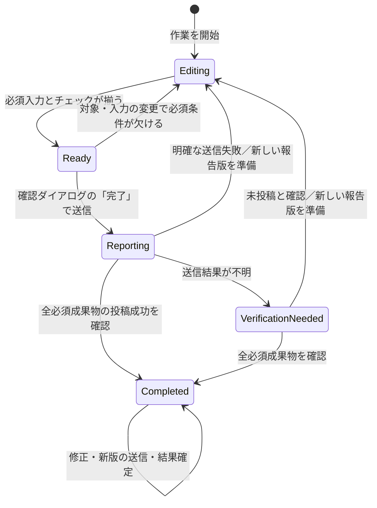
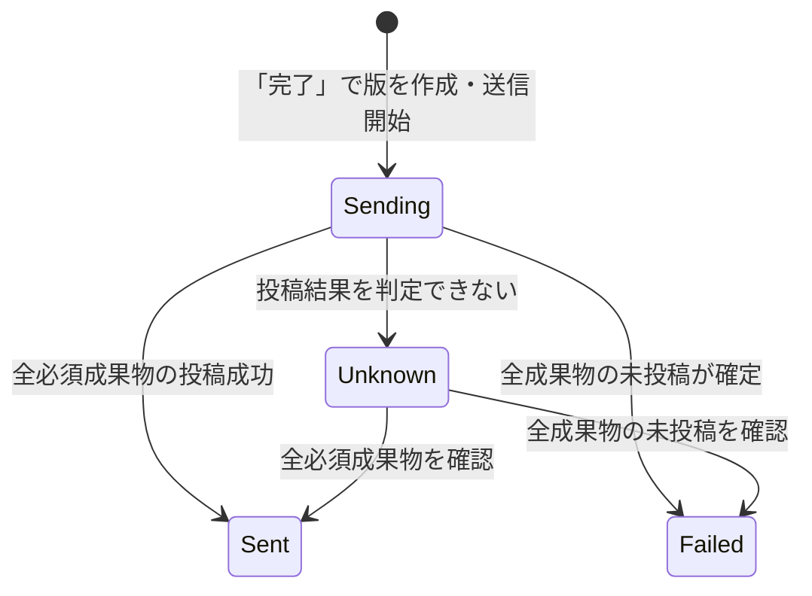
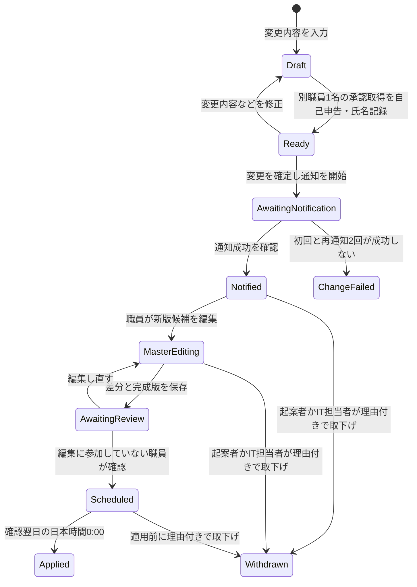
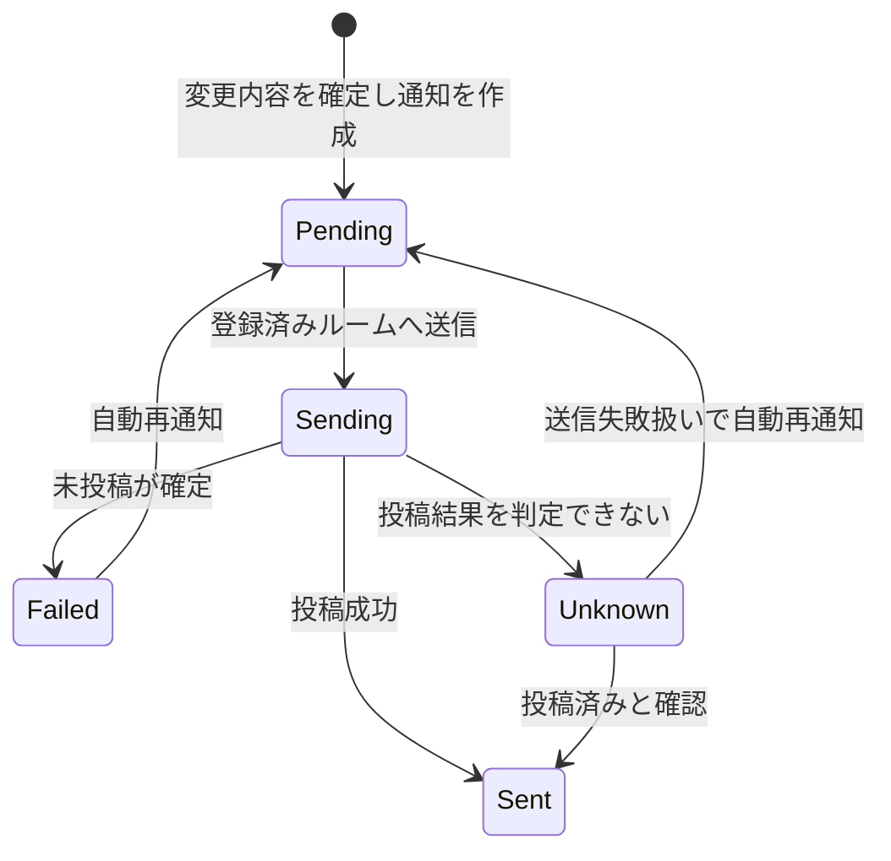

# KIIYA見落としチェッカー 状態遷移

## 1. 英語の名詞・状態名が指すもの

以下の英語は、この文書内の図とデータ項目で使う識別名。日本語の意味を先に定義する。

| 英語 | 日本語で指すもの |
| --- | --- |
| `WorkRecord` | 1回の清掃作業を表す記録。作業日、担当職員、清掃対象、チェック結果などをまとめる単位。 |
| `ReportVersion` | 確認ダイアログの「完了」で初めて永続化する報告の版。送信時点の内容を固定し、修正・再送時には別の版を作る。 |
| `ReportPreview` | 結果画面に表示する一時的なプレビュー。報告版や版番号を作らない。 |
| `WorkImageAttachment` | 作業全体の備考またはトラブル欄に添付した画像。 |
| `ReportImageSnapshot` | 報告確定時の画像の所属欄と保存物への参照を固定した写し。 |
| `MasterChange` | 現場設備、清掃項目、客室マスタの1回の変更候補。別職員1名の承認取得を自己申告して氏名を記録する。 |
| `Notification` | `MasterChange`を登録済みのChatworkルームへ知らせる1件の通知。報告書の送信とは別に扱う。 |
| `NotificationAttempt` | `Notification`の1回の送信試行。失敗・結果不明・成功を試行ごとに履歴へ残す。 |
| `LateNotificationEvidence` | 不成立になったマスタ変更の通知が後から投稿済みと分かった証拠。変更の適用状態とは独立して保存する。 |
| `Editing` | 作業記録を入力・修正中で、送信前の確認をまだ終えていない状態。 |
| `Ready` | 必須項目が揃い、内容確認を経て送信へ進める状態。 |
| `Reporting` | 作業記録から確定した報告版をChatworkへ送信している状態。 |
| `VerificationNeeded` | Chatworkへの送信結果が不明で、投稿の有無を確認する必要がある状態。 |
| `Completed` | その作業で少なくとも1版の報告が送信済みと確認できた状態。後の修正・再送が失敗してもこの実績は消さない。 |
| `Draft` | マスタ変更を作成・編集している状態。報告版には使わない。 |
| `Sending` | 報告版または通知をChatworkへ送信中の状態。 |
| `Sent` | Chatworkへの投稿が成功した、または投稿済みと確認できた状態。 |
| `Failed` | Chatworkへ投稿されていないことが分かった状態。 |
| `Unknown` | 通信断やタイムアウトなどで、Chatworkに投稿されたか判断できない状態。 |
| `AwaitingNotification` | マスタ変更の内容を確定し、Chatwork通知の成否を待っている状態。新版はまだ適用しない。 |
| `Notified` | Chatwork通知の成功を確認した状態。編集・内容確認・適用の完了は示さない。 |
| `MasterEditing` | 通知済み申請から職員が新版候補を編集している状態。 |
| `AwaitingReview` | 編集済みの差分と完成版を別職員が確認する前の状態。 |
| `Scheduled` | 独立した内容確認が終わり、新版が翌日0:00の適用を待つ状態。 |
| `Withdrawn` | 適用前に理由付きで取り下げた状態。 |
| `Applied` | 編集に参加していない別職員の確認が終わった翌日0:00（日本時間）に新版が有効になった状態。 |
| `ChangeFailed` | 初回送信と最大2回の自動再通知が成功せず、マスタ変更が不成立となった状態。新版を適用しない。 |
| `Pending` | マスタ変更のChatwork通知がまだ送信されていない状態。 |

## 2. 前提と確定済みのルール

- 状態は`WorkRecord`、`ReportVersion`、`MasterChange`、`Notification`ごとに分ける。画面を移動しただけでは状態を変えない。
- チェックで問題が見つかっても、その項目は確認完了にできる。問題の内容はアプリ内のトラブル欄に追記する。
- 休憩取得の「はい／いいえ」は報告前に回答する。「いいえ」も回答済みとして扱う。
- 清掃対象を途中で変更しても、既存のチェック結果は消さない。変更した旨を備考欄へ記載する。変更後の必須項目で報告可否を再判定し、報告書と履歴画面には現在の対象箇所だけを表示する。対象の客室では当日の宿泊人数を必須とし、子どもがいる場合はその人数も入力してから報告可能とする。定員・ベッド数は客室マスタの基本情報であり、当日の確認チェックには含めない。
- 報告後の修正・再送では元の`ReportVersion`を上書きせず、新しい版を作る。
- その日の操作は、Chatworkへの報告投稿が初めて成功したと確認できた時点で完了する。初回送信の失敗・結果不明では完了にしない。再報告中の状態は最新版の`ReportVersion`で別に示す〔2026-10-06承認、設計レビューで具体化〕。
- 報告送信が結果不明になった場合、当日担当職員または登録済みIT担当者がChatworkで投稿の有無を確認し、確認者・日時・根拠を記録して結果を確定する。
- マスタ変更は当日の担当職員が別職員1名の承認取得を自己申告し、その職員名を記録して確定する。承認者本人のアプリ操作は求めない。
- マスタ変更通知の成功は申請の伝達完了を示すだけで、新版を作成・適用しない。編集に参加していない別職員が画面で内容確認した翌日0:00（日本時間）に`Applied`へ進める。開始済み作業の参照版は変えない。通知失敗・結果不明の試行は送信失敗扱いで履歴に残し、申請者本人だけにアプリ内アラートを出す。初回送信後、失敗・結果不明が確定するたび5分後に最大2回自動再通知する。
- 同じ環境で通知中のマスタ変更は1件だけ。通知前に元版が現在有効な版か検査し、通知枠を確保する。競合時は通知せず`409`とする。通知結果が確定したら通知枠を解放する。通知済み申請は申請順に表示し、確認時に元版と適用予約を照合する。取下げには理由を残す。
- マスタ変更の通知履歴は最終結果が確定した時刻から1週間保存する。これは作業履歴の1週間とは別の期限とする。
- 日付が変わると当日の入力画面を新しい日の初期状態へ戻す。前日の`WorkRecord`は設定画面のアーカイブ閲覧リンクから参照でき、画面のリセットで記録を消去しない。
- 開いたまま日本時間の0時をまたいだ場合と、翌日の起動時の両方で切り替える。オフラインで未同期の前日入力は作業日を変えずに保持し、新しい日の入力へ混ぜない。
- 報告ボタン未押下の下書きと送信済み記録は無期限に保管する。押下後も未送信が確定した記録は初回押下から1週間、翌日以降はアーカイブで見られる。送信中・結果不明の版は結論が出るまで本文と生成物を削除せず保留する。`Sent`なら無期限保存、`Failed`なら初回押下から1週間の期限を再判定し、超過済みなら削除する。結果不明が発生した事実は独立して残し、再送でも起算点を更新しない。
- アーカイブへの表示切替は保存上の扱いであり、`Completed`や`VerificationNeeded`などの業務状態を上書きしない。
- 後から追加されたヒアリング内容に従い、客室には通常清掃／連泊（アメニティのみ）／連泊清掃の3種類を設ける。現在の種類で適用中の客室チェックのみ準備判定に含める。共用部は一覧の担当者・開始・完了で判定し、旧詳細チェックは求めない。
- 客室・ラウンジ・追加4箇所の「開始」で各実開始時刻を、トイレ・シャワー・洗面の「開始」でグループごとの実開始時刻を記録する。「完了」で各実終了時刻を記録する。開始前の完了と、開始より前の終了は認めない。トイレ0〜2、シャワー0〜3、洗面3の対象数をグループに持ち、実施数が対象数と一致したときに完了できる。トイレ・シャワーの個別の場所は指定しない。作業全体の予定開始9:55とは別の時刻として扱う。対象から外した客室などの時刻は内部に残すが報告・履歴には表示しない。

## 3. 清掃作業の状態（`WorkRecord`）

| 状態 | 利用者に許す操作と表示 |
| --- | --- |
| `Editing` | 入力・修正・自動保存を続ける。未完了の場所と項目があれば示す。送信前の確認が終わるまで報告送信はできない。 |
| `Ready` | 入力・修正と報告プレビューを行える。通信圏外でも記録を保持するが、送信は開始しない。 |
| `Reporting` | 送信中であることを示し、同じ報告版の送信操作を重ねて受け付けない。 |
| `VerificationNeeded` | 送信結果不明と報告識別子を示す。投稿の有無が分かるまで自動再送しない。 |
| `Completed` | 初回の送信済み実績と完了日時を残す。修正・再送中も`Completed`のまま、最新版の状態と未報告の修正の有無を併記する。 |

`Ready`は必須条件の再判定によって決まる。トラブル欄への記入だけを理由に、確認済みのチェックを未完了へ戻さない。

`WorkRecord.status`は初回送信までの進行と、送信済み実績を表す。`Completed`は一度成立したら戻さない。`hasSentReport`は送信済み版の存在から導出し、`latestReportVersionId`と`latestReportStatus`は最新版の`ReportVersion`から導出する。画面には「送信済みの報告あり」、最新版の送信状態、未報告の修正の有無を分けて表示する。修正を保存しても`Completed`のまま`hasUnreportedChanges=true`とし、最新版を送信できるかは現在の入力の準備判定で決める。最新版が`Sending`または`Unknown`の間は、送信済みの旧版があっても次の版の送信を受け付けない。`Failed`または`Sent`に確定した後は、準備判定と確認ダイアログを経て新しい版を作れる。旧版の`Sent`を新版の失敗で取り消さない。

| 操作 | 状態と時刻への影響 |
| --- | --- |
| 全体の必須チェックが揃う | 「報告結果画面へ進む」が有効になる。初回の送信済み版がなければ`WorkRecord`は`Ready`、あれば`Completed`のまま。 |
| 「報告結果画面へ進む」をタップ | 報告結果画面を表示する。1週間の起算点は記録しない。 |
| 「編集する」で本文を開き、キャンセルまたはOK | キャンセルは変更を破棄し、OKはプレビュー用本文を更新する。どちらも`WorkRecord`の送信状態・初回押下時刻・`ReportVersion`を変更しない。 |
| 報告結果画面下部の「報告」をタップ | 確認ダイアログを表示する。初回だけ押下時刻を記録し、1週間の起算点にする。初回送信前は`Ready`、送信済み版があれば`Completed`のまま。 |
| ダイアログをキャンセル | 送信せず、初回送信前は`Ready`、送信済み版があれば`Completed`のまま。記録済みの初回押下時刻は消さない。 |
| ダイアログの「完了」をタップ | 宛先・本文・形式を再確認して送信を開始する。初回送信前は`Reporting`へ移り、送信済み版があれば`Completed`を保って最新版を`Sending`にする。過去日付の作業ではダイアログでその旨を示し、送信内容にも明記する。 |

日付変更時に前日の記録はアーカイブ閲覧ページへ移る。未送信が確定し、送信中・結果不明の版もない記録は初回「報告」押下から1週間で削除する。結果不明の間は期限超過後も確認用の内容を保留する。報告ボタン未押下の下書きと送信済みの記録は、過去の記録となっても無期限に保管する。

## 4. 報告の版と送信結果（`ReportVersion`）

- 結果画面のプレビューと本文の編集は`ReportVersion`を作らない。確認ダイアログの「完了」で、作業の更新番号、編集済み本文、画像の同期状態、必須入力を検証し、`Sending`の版を1件作って版番号を割り当てる。`ReportVersion`の`Draft`・`Ready`は存在しない。ダイアログのキャンセルやプレビューの再生成では版番号を消費しない。
- `Sending`の版を作るトランザクションで、編集済み本文、サーバーが生成する最終送信本文、形式、宛先、作業結果、添付画像の写しを固定する。PDFには画像を埋め込み、画像ファイルも個別送信する。各ファイルの5 MB制限を送信前に確認し、制限内にできなければ版の作成を拒否する。`Sent`、`Failed`、`Unknown`になっても書き換えない。
- 本文・報告ファイル・各画像の送信結果を個別に残す。部分成功や一部の結果不明は報告全体を`Unknown`にし、全必須成果物の投稿を確認できた時だけ`Sent`にする。
- `Sent`後の修正・再送では、同じ`WorkRecord`から新しい`ReportVersion`を`Sending`で作る。
- `Failed`後の再送も、新しい版を作る。`Unknown`ではまず投稿の有無を確認し、未投稿と分かった場合に新しい版を作る。同じ版を無条件に再送しない。
- `Sending`開始から5分経っても確定結果がない場合、監視処理が報告IDでChatwork投稿を照合する。全必須成果物の投稿IDなど肯定的な証拠があれば`Sent`、全成果物の未投稿を確実に示せる証拠があれば`Failed`とする。直近メッセージに見つからないだけでは未投稿と断定せず、照合不能なら`Unknown`へ移し`DeliveryUncertaintyRecord`を作る。監視処理は1分ごとに期限超過を探し、再起動後も永続化した送信開始時刻から回復する。状態更新は版IDと現在状態を照合して一度だけ行い、遅れて到着した投稿成功の証拠は`Unknown`から`Sent`へ記録できる。`Unknown`を自動再送しない。
- `Sending`・`Unknown`は削除期限が来ても内容を保留する。結果が`Sent`ならその版を無期限に保存し、`Failed`なら初回押下からの期限を適用する。結果不明になった事実は別に残す。
- 報告版は作業ごとの単調増加番号と元版IDで結び付ける。本文削除後も番号を再利用しない。

## 5. マスタ変更と通知（`MasterChange`・`Notification`）

`MasterChange`が`AwaitingNotification`になると、対応する`Notification`を`Pending`で作る。失敗または結果不明の試行があっても、自動再通知中は`AwaitingNotification`のままで新版を適用しない。履歴には試行ごとの結果を残す。

- `Draft`から`Ready`には、当日の担当職員による別職員1名の承認取得申告と氏名記録が必要。自由入力名は本人確認には使わない。
- 通知試行が`Failed`または`Unknown`になった場合、更新操作をした本人にだけアプリ内アラートを表示する。履歴上はどちらも送信失敗扱いとし、`Unknown`だった事実も併記する。再通知の各試行は別の`NotificationAttempt`として残す。
- `Unknown`の再通知前には、通知本文に含めた変更IDをルームの直近メッセージで照合する案とする。投稿済みと確認できた場合は元の投稿日時と確認日時を別々に残して`Sent`に進める。見つからなければ自動再通知する。取得範囲に限りがあるため、重複投稿を完全には防げない。
- 通知が変更枠の有効期間中に`Sent`になった場合、変更は`Notified`となる。投稿日と成功確認日は監査用に記録する。適用日は後の独立した内容確認完了を起点に決める。すでに`ChangeFailed`なら自動復活させない。
- 変更候補の下書きは複数作れるが、`Ready`から`AwaitingNotification`へ進む操作は環境ごとに1件だけ許す。元版照合と変更枠の確保を同じトランザクションで行い、競合時は`409`で通知しない。`Notified`または`ChangeFailed`で通知枠を解放する。通知済み申請は申請順に表示し、独立した内容確認時に元版と同日の適用予約の競合を検査する。`ChangeFailed`後に古い投稿が見つかっても変更を自動復活させず、新しい変更として承認を取り直す。
- `ChangeFailed`後に投稿を発見した場合は`LateNotificationEvidence`へ元の変更ID、通知ID、Chatwork投稿ID、投稿日、発見日時、発見者と照合根拠、「変更不成立のため非適用」を記録する。変更状態と有効マスタは変えない。この証拠は発見から1年間保存し、7日で消える通知試行履歴や1年で消える変更内容とは独立して参照できる。
- 初回送信に加えて、失敗・結果不明の判定から5分後に最大2回再通知する。投稿済みとの照合に成功した場合は再通知せず`Sent`へ進める。3回の送信試行がいずれも成功せず、投稿済みとも確認できなければ`ChangeFailed`として打ち切り、新版を適用しない。通知と各試行の履歴は最終結果確定から1週間保存する。

## 6. 決定した境界条件

作業記録の権限、端末紛失・複数端末競合、報告版番号、画像送信、マスタ変更の承認・編集・確認・適用は[残る要件の決定](remaining-requirements-decisions.md)に定める。運用時に実際の職員アカウントを登録する。

関連文書: [要件定義](requirements.md)、[Chatwork認証の実装案](chatwork-auth-plan.md)
